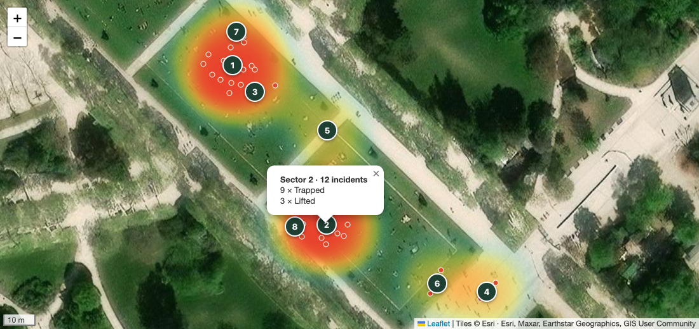
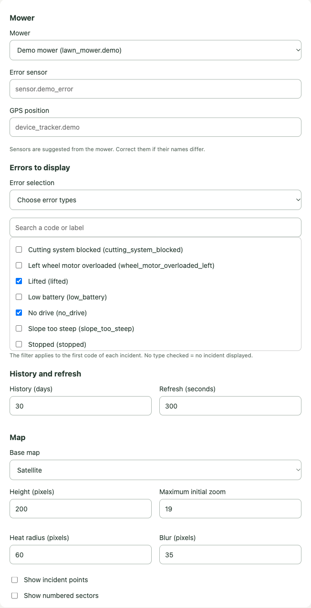

# Automower Heatmap Card

A Home Assistant dashboard card that shows **where your robotic mower gets into trouble**. It reads the mower error history from the recorder, finds the GPS position published just before each incident, and draws a heatmap of the hot spots over a satellite or OpenStreetMap base map.



*Demo with synthetic data.*

Typical uses: spotting the slope where it keeps slipping (`no_drive`), the hole where it gets `trapped`, the root that blocks the cutting system, and checking that a fix in the garden actually made the hot spot disappear.

## Requirements

- The official [Husqvarna Automower](https://www.home-assistant.io/integrations/husqvarna_automower/) integration, with a GPS-equipped mower. The card uses three entities of the mower:
  - `lawn_mower.<name>`
  - `sensor.<name>_error` (the error enum sensor, `no_error` when everything is fine)
  - `device_tracker.<name>` (GPS position)
- The [recorder](https://www.home-assistant.io/integrations/recorder/) keeping enough history. It keeps 10 days by default: raise `purge_keep_days` to look further back.

Any other `lawn_mower` integration exposing an error sensor with a `no_error` state and a GPS `device_tracker` should work too; error codes are expected to follow the Automower naming.

## Installation

### HACS (recommended)

1. HACS → ⋮ → **Custom repositories** → add `https://github.com/alepee/hass-automower_heatmap_card` with the **Dashboard** type.
2. Install **Automower Heatmap Card**, then reload the browser.

### Manual

1. Download `automower-heatmap-card.js` from the [latest release](https://github.com/alepee/hass-automower_heatmap_card/releases/latest) into `/config/www/`.
2. Settings → Dashboards → ⋮ → **Resources** → add `/local/automower-heatmap-card.js` as a **JavaScript module**.
3. Reload the browser.

## Configuration

Add the card from the dashboard editor (**Automower incident heatmap**) and pick the mower: the error sensor and the GPS tracker are suggested automatically from the mower device. Everything can be set from the visual editor.



```yaml
type: custom:automower-heatmap-card
entity: lawn_mower.my_mower
```

| Option | Default | Description |
|---|---|---|
| `entity` | *(required)* | The `lawn_mower` entity. |
| `error_entity` | `sensor.<name>_error` | Error sensor of the mower. |
| `tracker_entity` | `device_tracker.<name>` | GPS tracker of the mower. |
| `days` | `30` | Rolling period, in days (1 to 365). |
| `refresh_interval` | `300` | Refresh period, in seconds (30 to 86400). |
| `height` | `500` | Card height, in pixels. |
| `error_filter` | `terrain` | `terrain` (errors caused by the lawn: slopes, holes, obstacles, blocked wheels…), `all`, or `custom`. |
| `error_types` | `[]` | Error codes to show when `error_filter: custom`. An empty list shows nothing. |
| `map_type` | `satellite` | `satellite` (Esri World Imagery) or `plan` (OpenStreetMap). |
| `zoom` | `20` | Maximum initial zoom (10 to 22). |
| `heat_radius` | `60` | Heat radius, in pixels. |
| `heat_blur` | `35` | Heat blur, in pixels. |
| `show_points` | `false` | Show one point per incident, with its time and error codes in a popup. |
| `show_zones` | `false` | Group incidents within 10 m into numbered sectors, with the count per error in a popup. |

## How it works

- An **incident** runs from the first error code to the return to `no_error`. Unavailability does not create duplicates, and an error already active at the start of the period is ignored since its origin is unknown. The filter applies to the first code of the incident; later codes show in the point popup.
- An incident is placed at the **last GPS position published at most 5 minutes before it**. Incidents without such a position are left out of the map. A recent publication does not guarantee a recent satellite fix.
- GPS history is only fetched around incident onsets, not for the whole period, and cached in memory while the card is open.
- The map refreshes while the dashboard is visible and when you come back to the tab. Home Assistant keeps recording when the card is closed.
- Error labels come from Home Assistant's own translations of the error sensor, so they follow the user language. The card interface is available in English and French.

## Privacy

- History is read with the logged-in user session (`hass.callApi`). No token or history is stored in the card files.
- The map is rendered in a sandboxed iframe that has no access to the Home Assistant session.
- Base map tiles are loaded from Esri or OpenStreetMap, which therefore see the map area you are viewing.

## Development

```bash
npm install
npm test        # unit tests (node:test)
npm run build   # bundles dist/automower-heatmap-card.js
```

`demo/index.html` runs the card against synthetic data, without Home Assistant. Serve the repository root (`python3 -m http.server`) and open `/demo/index.html`. Query parameters: `points`, `zones`, `editor`, `filter=all`, `lang=fr`, `at=<lat>,<lon>`.

## License

MIT. The bundle includes Leaflet (BSD-2-Clause) and Leaflet.heat (MIT), see [THIRD_PARTY_LICENSES.md](THIRD_PARTY_LICENSES.md).
